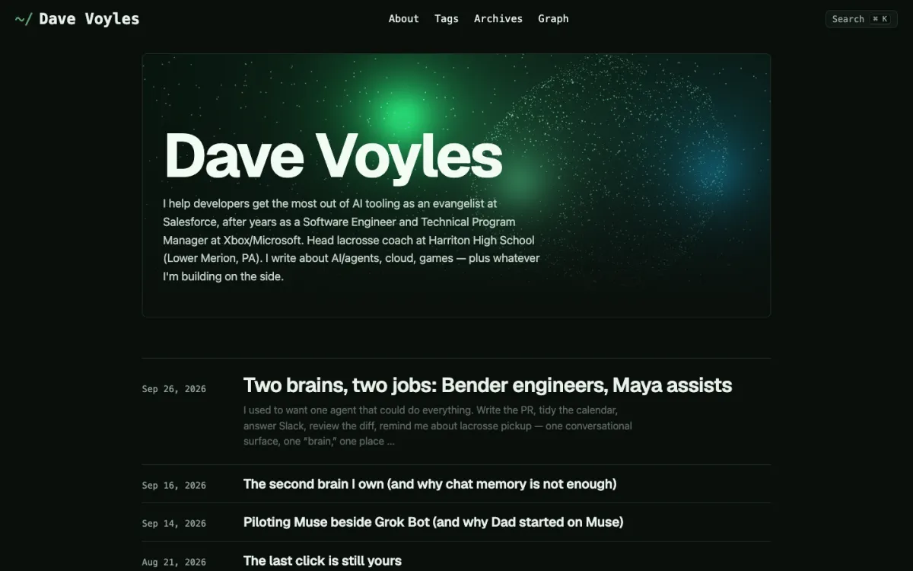

# davevoyles.com

**The source for Dave Voyles' personal website: his blog and portfolio, built from plain text files.**

Anyone can read it at davevoyles.com. No login, nothing to install.

- ✍️ **Blog**: posts about games, software and building with AI coding agents, written as plain Markdown.
- 🧭 **Home dashboard**: a hand-built front page with recent posts and projects.
- 🌌 **About page**: Dave's work and skills, with an interactive agent constellation.
- 🚦 **Publishing pipeline**: draft, content gate, publish. A human or an agent runs it the same way.
- 📦 **Static output**: Markdown in, HTML out. No server to break or go offline.

## What davevoyles.com is, and isn't

- **It is** a [Hugo](https://gohugo.io/) site on the PaperMod theme, deployed to GitHub Pages.
- **History:** it was rebuilt from scratch after the older version was shut down and lost.

## See it

- **[davevoyles.com](https://davevoyles.com)**: the live site.

## Get started in 3 steps

1. Fetch the theme once per fresh checkout: `make submodules`
2. Start the preview with drafts and future-dated posts: `make preview`
3. Open `http://localhost:1313/`, then try `/about/`, `/graph/` and `/archives/`.

## How it fits together

[Interactive version](docs/diagrams/overview.html)

---

You can stop here. Everything below is for developers and agents.

## For developers

- Write a post: [docs/authoring-guide.md](docs/authoring-guide.md)
- How the platform works: [docs/platform-guide.md](docs/platform-guide.md)
- Path-by-path repo map: [docs/repo-map.md](docs/repo-map.md)
- Home, About and WebGL surfaces: [docs/portfolio-surfaces.md](docs/portfolio-surfaces.md)
- Design system, plan and ADRs: [docs/DESIGN.md](docs/DESIGN.md), [docs/design/](docs/design/), [docs/decisions/](docs/decisions/)

## For agents

Start at [AGENTS.md](AGENTS.md), the router for coding agents. Claim-safe numbers and banned claims: [docs/claim-safe-facts.md](docs/claim-safe-facts.md). `make check` runs the content gates and must pass before anything lands.
